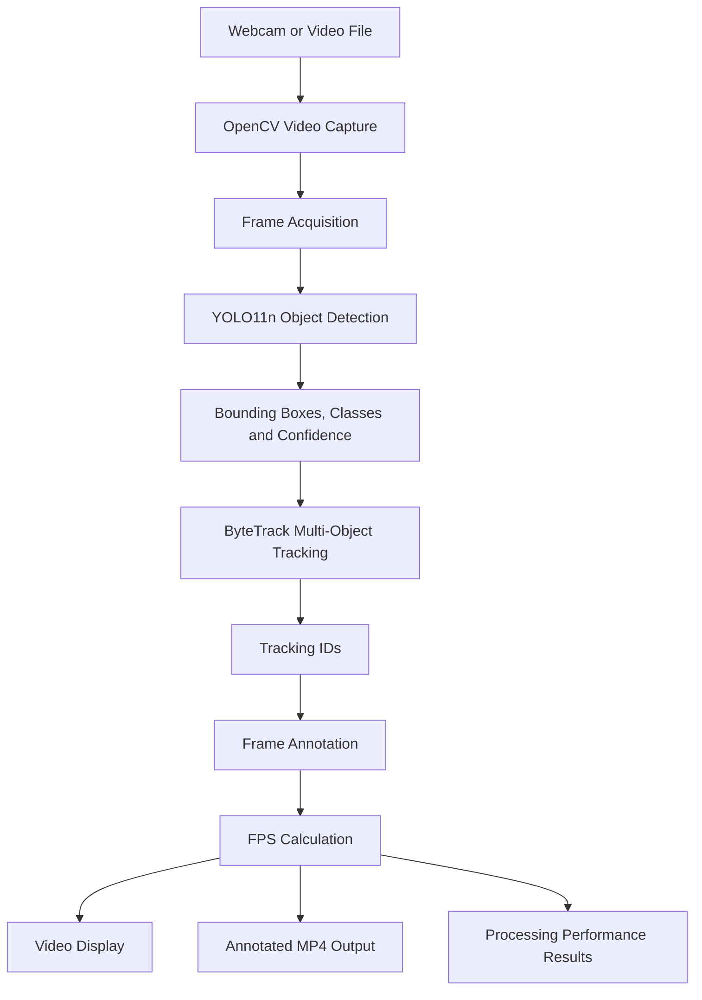
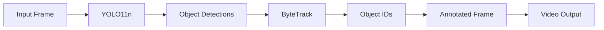
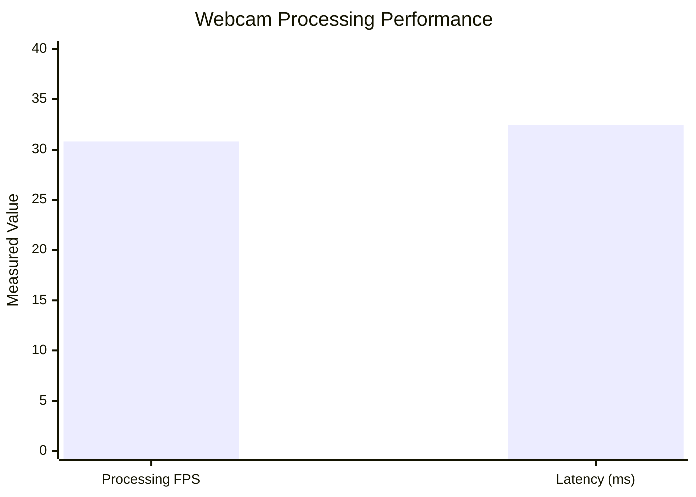
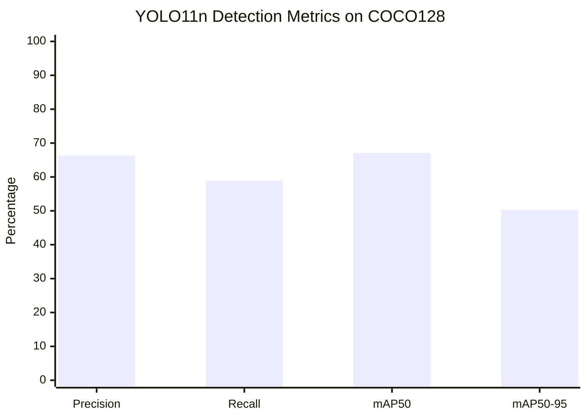

# Real-Time Object Detection and Multi-Object Tracking

**Real-time video analytics using YOLO11, ByteTrack, OpenCV, and Python**

A computer vision project that detects objects in webcam and recorded-video streams, maintains object identities across frames, produces annotated videos, and measures detection accuracy and processing performance.

**Developer:** Koushik Daggupati  
**GitHub:** [DGSKOUSHIK](https://github.com/DGSKOUSHIK)

---

## Project Overview

This project implements a real-time video object detection and multi-object tracking pipeline using a pretrained YOLO11n model and the ByteTrack tracking algorithm.

The application processes video frames using OpenCV, detects objects through YOLO11, and associates detections across consecutive frames using ByteTrack.

The processed video displays bounding boxes, detected classes, tracking IDs, and processing FPS.

The project also includes a benchmarking module that measures frame-processing speed and latency.

Detection accuracy was evaluated using the COCO128 dataset.

### Project Highlights

| Feature | Details |
|---|---|
| Project Type | Computer Vision |
| Programming Language | Python |
| Object Detector | YOLO11n |
| Tracking Algorithm | ByteTrack |
| Video Processing | OpenCV |
| Supported Input | Webcam and recorded video |
| Output | Annotated MP4 video |
| Benchmarking | FPS and latency |
| Accuracy Evaluation | COCO128 |
| mAP@50 | 67.1% |
| mAP@50–95 | 50.3% |
| Webcam Processing FPS | 30.82 |
| Average Processing Latency | 32.45 ms |
| Evaluation Device | CPU |
| Processor | Intel Core i7-13650HX |

---

## Problem Statement

Traditional object detection identifies objects in individual frames without necessarily maintaining their identities across time.

For video analysis, object detection alone is insufficient when the application needs to determine whether the same object continues appearing in consecutive frames.

Multi-object tracking addresses this challenge by associating detections across video frames.

This project combines object detection with tracking to provide:

- Object identification
- Bounding box localization
- Tracking ID assignment
- Continuous frame processing
- Annotated video generation
- Performance measurement

The system can serve as a starting point for video surveillance analytics, object counting, traffic monitoring, and other computer vision applications.

---

## Project Objectives

1. Develop a real-time object detection pipeline.
2. Integrate YOLO11n for detecting objects.
3. Apply ByteTrack for multi-object tracking.
4. Process webcam and recorded-video streams.
5. Display object bounding boxes and tracking IDs.
6. Save annotated output videos.
7. Measure processing FPS and latency.
8. Generate benchmark reports.
9. Evaluate detection accuracy using COCO128.
10. Document reproducible commands and measured results.

---

## Key Features

### Object Detection

Uses pretrained YOLO11n weights to identify objects from supported detection classes.

### Multi-Object Tracking

Integrates ByteTrack through the Ultralytics tracking interface to associate objects across frames.

### Webcam Support

Processes video from a connected webcam.

### Recorded Video Support

Accepts video files as input.

### Annotated Output

Saves processed frames with object bounding boxes and tracking information.

### Real-Time FPS Display

Displays estimated per-frame processing FPS.

### Performance Benchmarking

Measures:

- Processing FPS
- Average latency
- Median latency
- P95 latency
- P99 latency

### Detection Accuracy Evaluation

Evaluates YOLO11n detection accuracy using a labeled dataset.

---

## Technology Stack

| Technology | Purpose |
|---|---|
| Python | Application development |
| Ultralytics YOLO11 | Object detection |
| ByteTrack | Multi-object tracking |
| OpenCV | Video capture, annotation, and output |
| NumPy | Numerical calculations |
| Git | Version control |
| GitHub | Source code hosting |

---

## System Architecture

The application follows a frame-by-frame video processing pipeline.



### Processing Workflow

1. Open the video source using OpenCV.
2. Capture the next video frame.
3. Run YOLO11 object detection.
4. Extract detection results.
5. Associate detections using ByteTrack.
6. Generate an annotated frame.
7. Calculate processing time.
8. Display the annotated frame.
9. Write the frame to an output video.
10. Continue until the video ends or the user presses Q.

---

## Detection and Tracking Workflow



### YOLO11 Object Detection

YOLO11 performs object detection by predicting:

- Object bounding boxes
- Class labels
- Confidence scores

The project uses pretrained `yolo11n.pt` weights.

### ByteTrack Tracking

ByteTrack associates detections across frames to maintain object identities.

The project uses the Ultralytics tracking interface:

```python
results = model.track(
    frame,
    persist=True,
    tracker="bytetrack.yaml",
    conf=0.25,
    verbose=False
)
```

The `persist=True` setting enables tracking information to persist across consecutive frame-processing calls.

### OpenCV

OpenCV handles:

- Webcam access
- Video file reading
- Frame acquisition
- FPS text rendering
- Video display
- MP4 output generation

---

## Repository Structure

```text
Real-Time-Object-Detection-and-Tracking/
|
|-- README.md
|-- main.py
|-- benchmark.py
|-- requirements.txt
|-- .gitignore
|
`-- reports/
    `-- benchmark.csv
```

### File Descriptions

| File | Purpose |
|---|---|
| `main.py` | Real-time detection, tracking, and video output |
| `benchmark.py` | Video processing performance evaluation |
| `requirements.txt` | Python dependencies |
| `.gitignore` | Excludes temporary and generated files |
| `reports/benchmark.csv` | Saved benchmark results |
| `README.md` | Project documentation |

---

## Installation

### Prerequisites

- Python 3.11 or another compatible version
- Git
- Internet connection for first-time model downloads
- Webcam or recorded video
- Supported Windows, Linux, or macOS environment

### Step 1: Clone the Repository

```bash
git clone https://github.com/DGSKOUSHIK/Real-Time-Object-Detection-and-Tracking.git
cd Real-Time-Object-Detection-and-Tracking
```

### Step 2: Create a Virtual Environment

```bash
python -m venv .venv
```

Activate the environment on Windows CMD:

```cmd
.venv\Scripts\activate
```

On Linux or macOS:

```bash
source .venv/bin/activate
```

### Step 3: Install Dependencies

```bash
python -m pip install -r requirements.txt
```

The application uses Ultralytics, OpenCV, NumPy, and their required dependencies.

---

## Running the Project

### Run Real-Time Webcam Detection

```bash
python main.py --source 0
```

This starts detection and tracking using the default webcam.

### Run Detection on a Recorded Video

```bash
python main.py --source test.mp4
```

Replace `test.mp4` with the path to your video.

### Specify Output Video

```bash
python main.py --source test.mp4 --output outputs/result.mp4
```

### Specify a Model

```bash
python main.py --source 0 --model yolo11n.pt
```

### Stop Processing

Click the video window and press **Q**.

### Generated Output

The default annotated video is saved to:

```text
outputs/tracked_video.mp4
```

---

## Experimental Setup

The system was tested using a Windows environment.

| Component | Configuration |
|---|---|
| Processor | Intel Core i7-13650HX |
| Python | 3.11.9 |
| Ultralytics | 8.4.191 |
| Detection Model | YOLO11n |
| Tracking Algorithm | ByteTrack |
| Detection Validation Dataset | COCO128 |
| Validation Input Size | 640 |
| Detection Validation Device | CPU |
| Webcam Frames Processed | 1,086 |

Detection accuracy and webcam processing speed were measured in separate experiments.

---

## Experimental Results

### 1. Webcam Processing Performance

The webcam experiment processed 1,086 frames.

| Metric | Result |
|---|---:|
| Total Frames | 1,086 |
| Average Processing FPS | **30.82** |
| Mean Processing Latency | **32.45 ms** |

These measurements cover the timed tracking and annotation operations in the application.

Camera capture, video display, and output-file writing are not included in the reported per-frame processing latency.

### Performance Summary



The graph places FPS and latency values on the same numeric scale for a compact summary. They have different units and should be interpreted separately.

### 2. Detection Accuracy on COCO128

The pretrained YOLO11n model was evaluated using COCO128.

| Metric | Result |
|---|---:|
| Validation Images | 128 |
| Ground-Truth Instances | 929 |
| Precision | 66.3% |
| Recall | 58.9% |
| mAP@50 | **67.1%** |
| mAP@50–95 | **50.3%** |
| CPU Inference Time | 30.8 ms/image |

### Detection Performance Graph



### Result Interpretation

**Precision: 66.3%**

Measures the proportion of predicted detections considered correct at the evaluation settings used.

**Recall: 58.9%**

Measures the proportion of ground-truth objects successfully detected.

**mAP@50: 67.1%**

Measures mean average precision using an Intersection over Union threshold of 0.50.

**mAP@50–95: 50.3%**

Measures mean average precision averaged across IoU thresholds from 0.50 to 0.95.

These results describe the pretrained model's detection performance on COCO128, not the accuracy of ByteTrack identity association.

---

## Performance Benchmarking

The project includes `benchmark.py` for measuring tracking-processing performance over a specified number of frames.

### Benchmark a Webcam

```bash
python benchmark.py --source 0 --frames 300
```

### Benchmark a Video File

```bash
python benchmark.py --source test.mp4 --frames 300
```

### Available Benchmark Metrics

| Metric | Description |
|---|---|
| Frames | Number of frames processed |
| FPS | Frames processed per second of measured computation |
| Mean Latency | Average processing time per frame |
| Median Latency | Middle observed latency |
| P95 Latency | 95th percentile of processing times |
| P99 Latency | 99th percentile of processing times |

The benchmark saves results to:

```text
reports/benchmark.csv
```

The benchmark focuses on model tracking calls and does not measure complete video capture-to-display latency.

---

## Detection Accuracy Validation

To reproduce the COCO128 detection evaluation, run:

```bash
yolo detect val model=yolo11n.pt data=coco128.yaml imgsz=640 device=cpu
```

The command evaluates the pretrained detector and reports:

- Precision
- Recall
- mAP@50
- mAP@50–95
- Per-class detection results

The validation outputs are saved in the local Ultralytics `runs` directory.

### Important Evaluation Distinction

Detection mAP and multi-object tracking accuracy are different measurements.

Detection mAP measures how well predicted bounding boxes correspond to labeled objects.

Tracking metrics such as IDF1, HOTA, and MOTA evaluate identity association and tracking behavior over video sequences.

The current project reports detection mAP, but dedicated tracking accuracy metrics have not yet been measured.

---

## Implementation Details

### Frame Capture

OpenCV's `VideoCapture` reads frames from the selected input source.

### Detection

The YOLO11n model processes each frame and predicts object detections.

### Tracking

ByteTrack associates object detections between consecutive frames.

### Annotation

The Ultralytics plotting interface draws detection and tracking information on the frame.

### Performance Measurement

Python's `time.perf_counter()` measures frame-processing time.

Instantaneous processing FPS is calculated as:

```text
FPS = 1 / Frame Processing Time
```

Average processing latency is calculated as:

```text
Mean Latency = Total Processing Time / Processed Frames
```

The application converts latency values into milliseconds.

### Video Export

OpenCV's `VideoWriter` stores annotated frames in MP4 format.

---

## Limitations

The current implementation has several limitations.

1. The detector uses pretrained YOLO11n weights rather than a custom-trained model.
2. Detection accuracy was evaluated on COCO128, not on an independently labeled webcam dataset.
3. Tracking performance has not been evaluated using IDF1, HOTA, or MOTA.
4. Processing speed depends on hardware and runtime configuration.
5. Webcam processing latency excludes capture, display, and output-writing overhead.
6. The initial performance test uses a limited number of frames.
7. Tracking behavior may be affected by occlusion, motion blur, and crowded scenes.
8. Extended recorded-video evaluation and automated tests remain future improvements.

---

## Future Enhancements

Potential improvements include:

- Tracking evaluation using MOT-style datasets
- IDF1, HOTA, and MOTA measurement
- Object counting
- Line-crossing detection
- Multi-camera support
- Improved track visualization
- Streamlit analytics dashboard
- FastAPI integration
- Per-frame performance logging
- GPU acceleration
- ONNX Runtime optimization
- Automated tests
- More extensive video benchmarks

These features are proposed future work and are not represented as completed functionality.

---

## Project Status

| Component | Status |
|---|---|
| GitHub Repository | Completed |
| YOLO11 Detection | Implemented |
| ByteTrack Integration | Implemented |
| Webcam Processing | Tested |
| Video Output | Implemented |
| FPS Measurement | Completed |
| Average Latency Measurement | Completed |
| Benchmark CSV Export | Implemented |
| COCO128 Validation | Completed |
| Detection mAP Evaluation | Completed |
| Tracking IDF1 / HOTA | Not yet evaluated |
| Dashboard | Planned |
| Automated Testing | Planned |

---

## Applications

Possible applications of this project include:

- Video surveillance analytics
- Traffic monitoring
- Object movement analysis
- Crowd monitoring
- Automated video processing
- Computer vision research
- Multi-object tracking experiments

The current implementation is a basic video analytics pipeline, not a production-ready surveillance platform.

---

## Conclusion

This project implements real-time object detection and multi-object tracking using pretrained YOLO11n, ByteTrack, and OpenCV.

The application supports webcam and recorded-video processing, visualizes detection results, and exports annotated MP4 videos.

In the initial webcam experiment, the system processed **1,086 frames at 30.82 processing FPS**, with an average processing latency of **32.45 ms**.

The pretrained detector achieved **67.1% mAP@50 and 50.3% mAP@50–95** on the COCO128 evaluation dataset.

The project also includes a benchmark script for measuring processing speed and latency.

Future work will focus on tracking accuracy evaluation, more extensive video testing, and additional analytics features.

---

## Developer

**Koushik Daggupati**

GitHub: [DGSKOUSHIK](https://github.com/DGSKOUSHIK)

Project Repository: [Real-Time-Object-Detection-and-Tracking](https://github.com/DGSKOUSHIK/Real-Time-Object-Detection-and-Tracking)

---

**Python | YOLO11 | ByteTrack | OpenCV | Computer Vision | Video Analytics**
